# Course Hub

Keeps the **Course Materials** library for East West University courses in one consistent shape
across Google Drive, GitHub and a public website, and files new Google Classroom posts into it automatically.

**Live:** https://course-hub.sadmananik.workers.dev  ·  **Content:** [Sadman-11/Course-Materials](https://github.com/Sadman-11/Course-Materials)

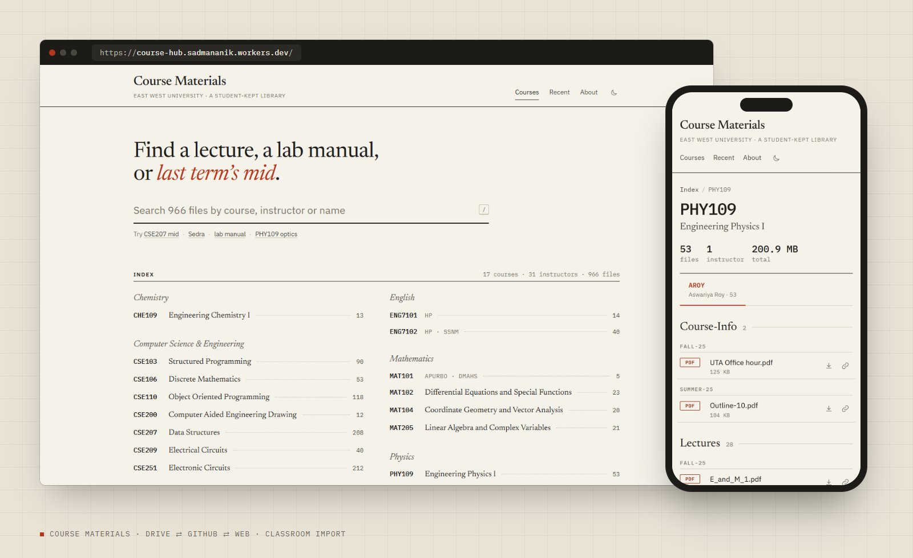

<sub>Screens show the real file list as it will look after the planned reorganisation. Dashboard screens use demo accounts and demo Classroom data.</sub>

## What it looks like

| | |
|---|---|
| 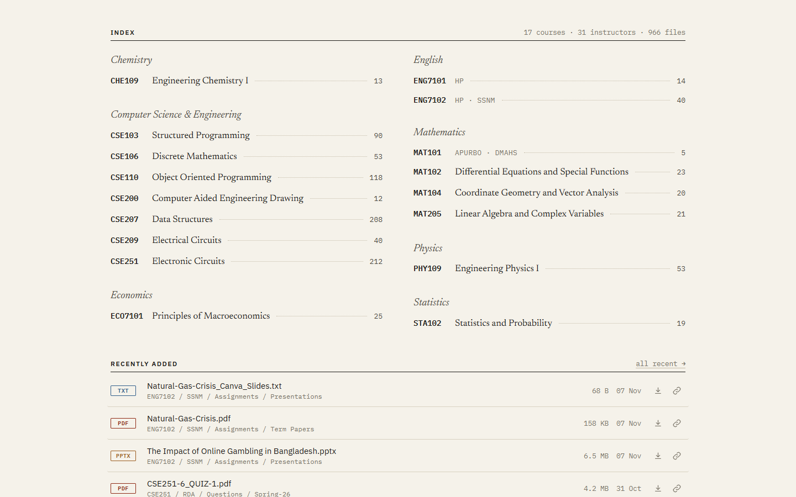 | 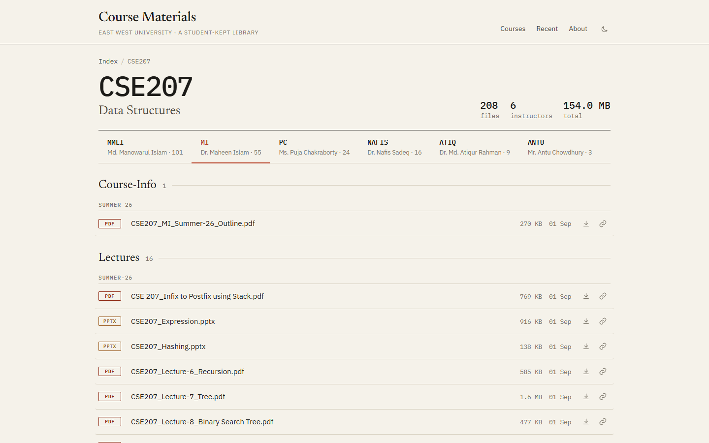 |
| **Index.** Every course, grouped by department, with titles from the official outlines. | **Course page.** Instructor tabs, then the same nine categories in the same order for every course. |
| 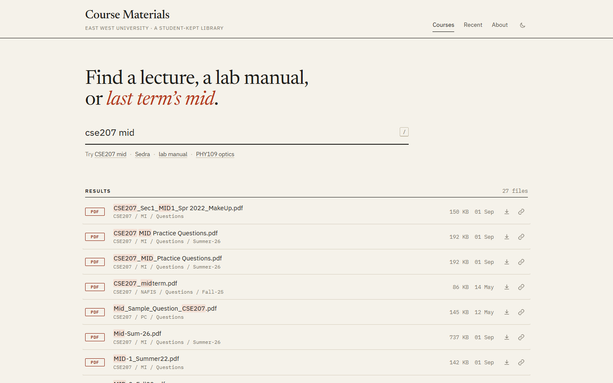 | 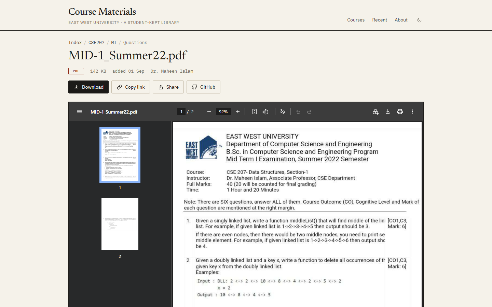 |
| **Search.** Instant, across 966 files; type `/` anywhere. `cse 207` and `CSE207` both work. | **File page.** Inline preview, download, copy link, native share on phones, open in Drive or GitHub. |
| 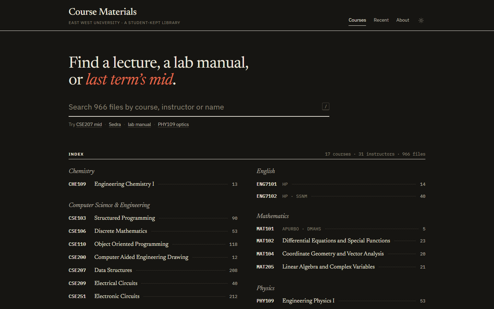 | 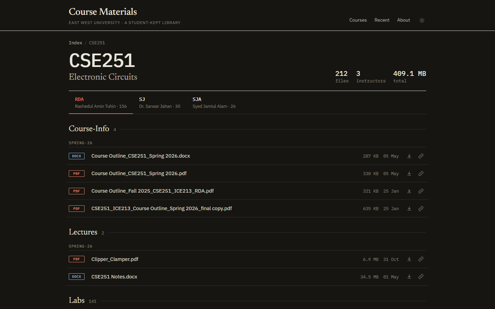 |
| **Dark mode** follows the system, with a toggle. | |

<p align="center">
  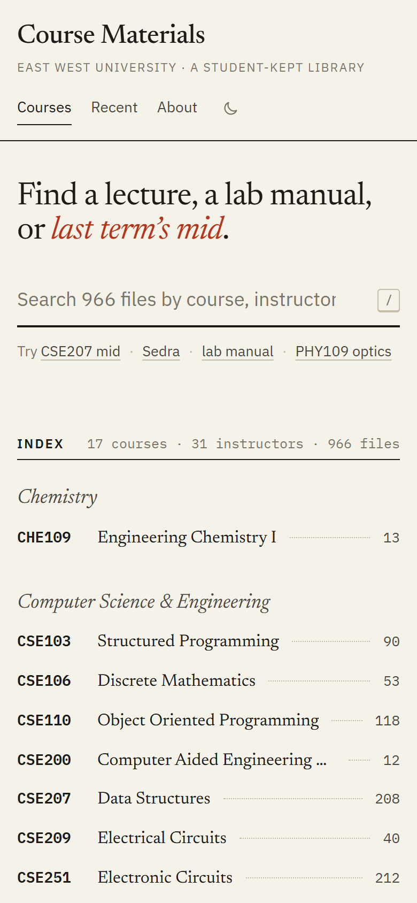
  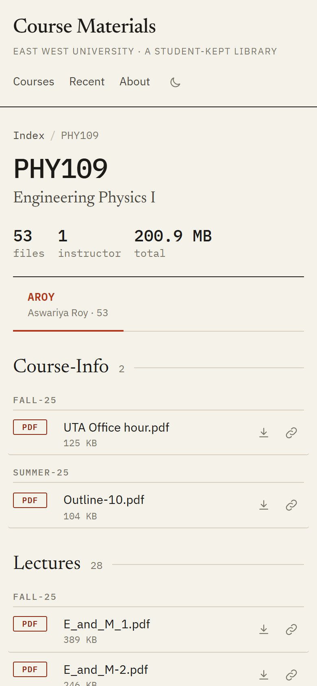
  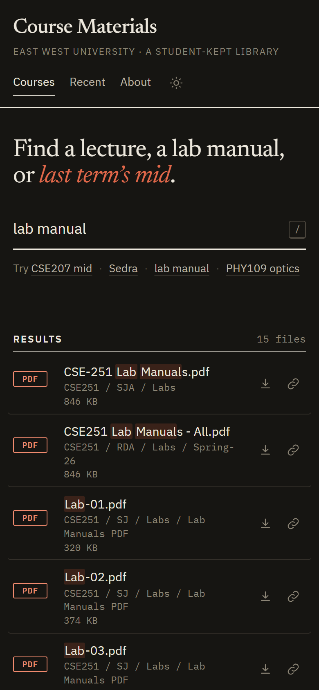
</p>

### Dashboard (`/admin`)

| | |
|---|---|
| 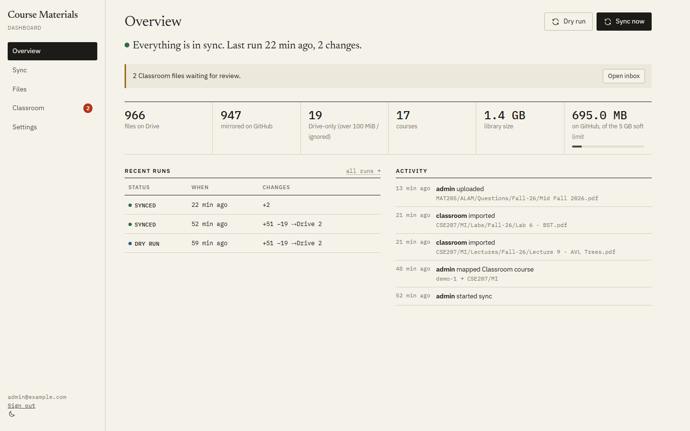 | 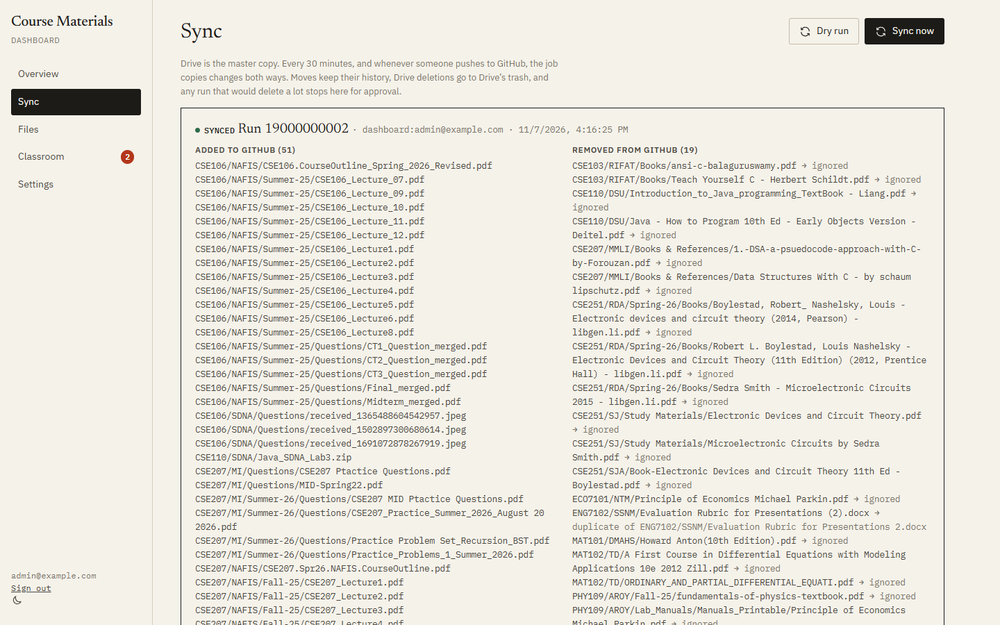 |
| **Overview.** Health in one sentence, library and GitHub size, alerts (disconnected accounts, expiring tokens, runs waiting for approval), activity. | **Runs.** What each sync added, moved, removed or kept Drive-only. Runs that would delete a lot stop here for approval. |
| 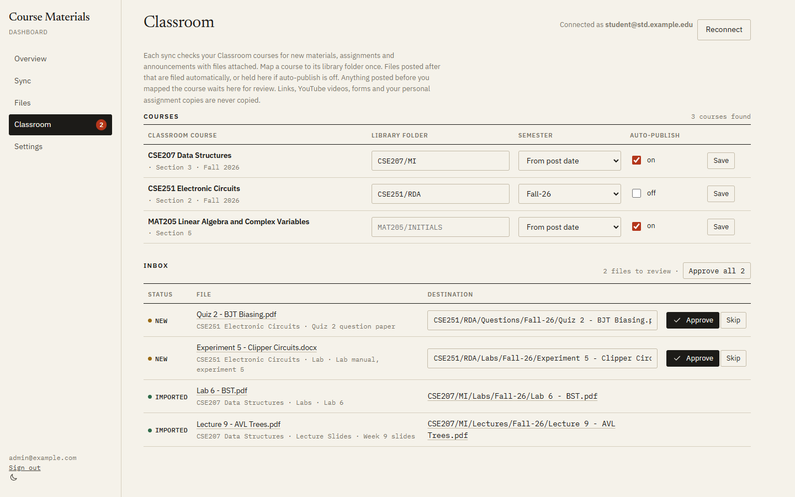 | 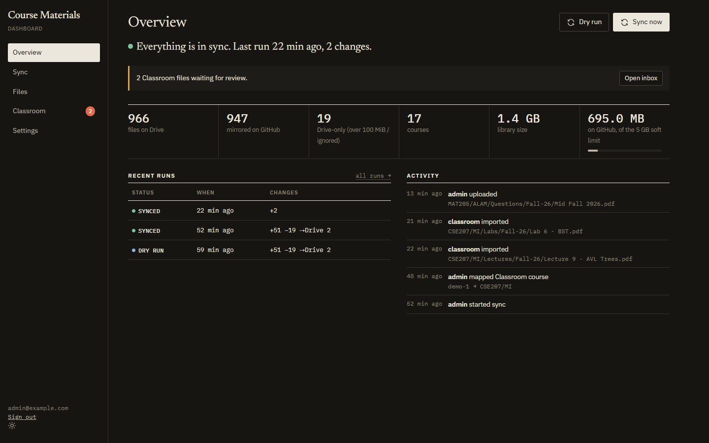 |
| **Classroom.** Map each course to its library folder once. New posts are filed automatically; older ones wait in the inbox. | Also in dark mode. |

## How it fits together

```
 Google Classroom ──(new posts)──┐
                                 ▼
                    ┌──────────────────────────┐   every 30 min, on GitHub pushes,
                    │ Sync job (GitHub Actions) │◄── or "Sync now" in the dashboard
                    │ sync/index.js             │
                    └──────┬─────────────┬──────┘
         Drive API (moves, │             │ git plumbing on a blobless clone
         uploads, trash)   ▼             ▼ (a few MB per run, not 1.4 GB)
                ┌────────────────┐   ┌──────────────────────────────┐
                │ Google Drive    │◄─►│ GitHub: Course-Materials      │
                │ (master copy)   │   │ (+ .sync/state.json)          │
                └───────┬────────┘   └──────────────────────────────┘
                        │ Drive-only files        │ raw files @ commit
                ┌───────┴─────────────────────────┴─────────────────┐
                │ Cloudflare Worker (worker/)                        │
                │  /             public library                      │
                │  /admin        dashboard                           │
                │  /api/internal token broker + reports for the job  │
                │  D1            catalog, runs, Classroom inbox,     │
                │                encrypted Google grants             │
                └────────────────────────────────────────────────────┘
```

## Library layout

Every course has the same shape. The rules live in [`shared/taxonomy.js`](shared/taxonomy.js) and are used by
the sync job, the reorganiser, the Classroom importer, the upload form and the site.

```
COURSE / INSTRUCTOR / Category / [Semester] / [sub-folders…] / file
CSE207 / MI         / Questions / Summer-26  / CSE207 MID Practice Questions.pdf
```

* **Course** is the code (`CSE207`). **Instructor** is the faculty initials (`MI`). Course-wide files go under `General`.
* **Category** is always one of nine, always in this order: `Course-Info`, `Lectures`, `Labs`, `Assignments`, `Questions`,
  `Practice`, `Projects`, `Books`, `Code`.
* **Semester** is optional, written `Spring-26`, `Summer-26` or `Fall-26` (EWU terms).

Git can't store empty folders, so a category folder only exists where it has files.
The site always shows categories in the order above.

## How the sync behaves

| Situation | Result |
|---|---|
| New or edited file on Drive | added or updated on GitHub, byte-for-byte (CRLF kept) |
| File moved or renamed on Drive | a **Git rename**. Files are tracked by Drive ID, so nothing is re-uploaded |
| New or edited file pushed to GitHub | copied to Drive |
| Deleted on Drive | removed from GitHub (still in Git history) |
| Deleted on GitHub | moved to **Drive's trash** (recoverable for 30 days) |
| Edited on both since the last sync | Drive wins. The GitHub version stays in history, and the run reports a conflict |
| Over 100 MiB, or matched by `.syncignore` | **Drive-only**. The site streams it from Drive. Textbooks are Drive-only |
| Would delete more than max(10, 3%) of files | **stops**. The dashboard lists the files and offers "Approve" for exactly that plan |
| Drive listing comes back empty | refuses to run, so a wrong folder or lost access can never wipe GitHub |

State lives in `.sync/state.json` in the content repo and is committed together with each change.
Google Docs/Sheets/Slides are mirrored to GitHub as read-only PDF/XLSX exports.

### Classroom

Classroom can be connected with a different Google account from the one that owns Drive, such as a university account.
The job lists your active courses. Once a course is mapped to a library folder (`CSE207/MI`):

* Files attached to materials, assignments and announcements posted **after** the mapping are filed automatically
  under `CSE207/MI/<Category from the topic or file name>/<Semester>/`. If auto-publish is off for that course, they're held for review instead.
* Anything posted before the mapping waits in the **Inbox**. Approve items one at a time or all at once.
* Links, YouTube videos, forms and per-student assignment copies are never copied.
* A file whose content is already in the library isn't duplicated.

## Setup

You never paste a secret into a file in this repo. Secrets go straight to Cloudflare or GitHub with the commands below,
and Google sign-in happens in your browser.

**1. Cloudflare**
```sh
npm install
npx wrangler login
npx wrangler d1 create course-hub          # put the database_id in wrangler.jsonc
npx wrangler d1 migrations apply course-hub --remote
```

**2. Google Cloud OAuth client** (console.cloud.google.com)
1. Create a project and enable the **Google Drive API** and the **Google Classroom API**.
2. Under **OAuth consent screen**, choose user type **External**, add the scopes below, then **Publish app**.
   In "Testing" mode Google expires refresh tokens after 7 days. An unverified published app still works for you:
   Google shows an "unverified app" screen once (Advanced → Continue).
   Scopes: `drive`, `drive.readonly`, `classroom.courses.readonly`, `classroom.coursework.me.readonly`,
   `classroom.courseworkmaterials.readonly`, `classroom.announcements.readonly`, `classroom.topics.readonly`,
   `openid`, `email`, `profile`.
3. Under **Credentials**, create an **OAuth client ID** of type *Web application*, with this authorised redirect URI:
   `https://<your-worker>.workers.dev/auth/callback`
4. Put the client ID (it ends in `.apps.googleusercontent.com`) in `wrangler.jsonc` as `GOOGLE_CLIENT_ID`, and set `PUBLIC_URL`.

**3. GitHub token for the Worker.** Create a fine-grained PAT for the content repository only, with **Actions: read & write**
and **Contents: read**. It can start syncs but can't write content.

**4. Secrets**
```sh
npx wrangler secret put ADMIN_EMAILS          # comma-separated Google accounts allowed into /admin
npx wrangler secret put GOOGLE_CLIENT_SECRET
npx wrangler secret put GITHUB_TOKEN
node -e "process.stdout.write(require('crypto').randomBytes(32).toString('base64url'))" | npx wrangler secret put SESSION_SECRET
node -e "process.stdout.write(require('crypto').randomBytes(32).toString('base64url'))" | npx wrangler secret put TOKEN_KEY
node -e "process.stdout.write(require('crypto').randomBytes(32).toString('base64url'))" | tee .sync-token | npx wrangler secret put SYNC_TOKEN
npm run deploy
```

**5. Content repo**
* Copy `content-repo/.github/workflows/sync.yml`, `content-repo/.gitattributes` and `content-repo/.syncignore` into it.
* Add repo variables `DRIVE_ROOT_ID` (the library folder's ID) and `SYNC_API` (the Worker URL),
  and the repo secret `SYNC_TOKEN`: `gh secret set SYNC_TOKEN < .sync-token`, then delete `.sync-token`.
* The workflow checks this repo out to get the engine, so this repo should stay public. It contains code only, no secrets.

**6. Connect accounts.** Open `/admin` and sign in. Then go to **Settings**:
**Connect Google Drive** with the account that owns the library folder, and **Connect Google Classroom**
with the account you take classes with.

## First run, in order

1. **Dashboard → Dry run.** On today's data it should show: 51 Drive files added to GitHub, 925 verified identical
   (152 of them get their original CRLF bytes back), 18 textbooks and 1 stray duplicate taken off GitHub,
   2 GitHub-only zips copied to Drive, and 20 Drive-only files (the textbooks plus one 135 MiB video).
2. **Sync now.** This bootstrap links every Drive ID to its Git path. The reorganisation depends on it.
3. **Reorganise Drive.** Review [`reorg/PLAN.md`](reorg/PLAN.md) first.
   ```sh
   node --env-file=.env sync/index.js --list-drive=data/drive-manifest.json   # fresh listing
   node tools/reorg-plan.mjs data/drive-manifest.json reorg                       # rebuild the plan if Drive changed
   bash tools/rehearse.sh data/drive-manifest.json                                # optional full local rehearsal
   node --env-file=.env tools/reorg-apply.mjs reorg/plan.json                     # dry run
   node --env-file=.env tools/reorg-apply.mjs reorg/plan.json --apply             # do it (writes an undo log)
   ```
   `.env` holds `SYNC_API`, `SYNC_TOKEN`, `DRIVE_ROOT_ID` and `GITHUB_REPO`, and is git-ignored.
4. **Sync now** again. It stops to ask about the ~31 duplicate removals. That's the guard working; approve them in the dashboard.
   GitHub then gets one commit of ~920 renames.
5. **Classroom.** Map each course to its folder.

To roll back the reorganisation, run `node --env-file=.env tools/reorg-apply.mjs --undo=reorg/applied-<time>.json --apply`, then sync.

## Day to day

* **Add files** in any of three ways: drop them in the right Drive folder, use **Files → Add files** in the dashboard
  (it builds the canonical path for you), or `git push` to Course-Materials. All three end up everywhere.
* **Keep something off GitHub** by adding a pattern to `.syncignore` in Course-Materials.
* **Tokens.** The dashboard warns 30 days before the GitHub token expires. If Google revokes a grant, it shows a Reconnect button.

## Repo map

| Path | What |
|---|---|
| `shared/taxonomy.js` | the layout rules (single source of truth) |
| `sync/` | sync engine and Classroom importer (Node 20+, no dependencies) |
| `sync/test/` | 29 tests: every reconciliation case, plus end-to-end runs on real git (blobless clone and push) |
| `worker/` | Cloudflare Worker: site, dashboard API, OAuth, token broker, cron |
| `web/` | site and dashboard frontend (no framework, no build step) |
| `tools/` | `reorg-plan`, `reorg-apply` (with undo), `rehearse.sh`, `syncignore-books` |
| `reorg/` | the reviewed plan: `PLAN.md`, `plan.csv`, `plan.json` |
| `content-repo/` | files to install in Course-Materials |
| `data/` | instructor names (initials → name), course titles (from official outlines), the Drive listing the plan was built from |
| `docs/screenshots/` | README images, made with `scripts/screenshots.mjs` (headless Chrome, no dependencies) |

## Local development

```sh
cp .dev.vars.example .dev.vars          # fill in random values and your admin email
npm run db:migrate:local
npx wrangler dev
node scripts/seed-local.mjs data/drive-manifest-2026-11-07.json http://127.0.0.1:8787
node scripts/dev-session.mjs you@example.com    # prints a value for the ch_session cookie (local only)
npm test
```

## Things to know

* **Repo size.** GitHub holds 1.3 GB today, against a 5 GB soft limit. Every edit to a big PDF adds a full copy to history.
  Moving the textbooks to Drive-only takes ~650 MB off the tree. They stay in earlier Git history unless that history is rewritten.
* **Copyright.** Textbooks are Drive-only for this reason. The public site still lists and streams them from Drive.
* **University Google accounts.** A Workspace admin can block unverified third-party apps. If connecting Classroom fails with
  "access blocked", ask IT to allow the app, or join the classes with a personal account.
